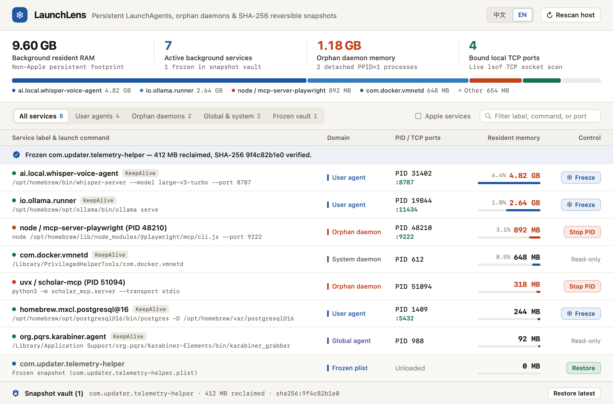

# LaunchLens

**English** | **[简体中文](README.zh-CN.md)**

**macOS user `LaunchAgents` and background service RSS ledger with deduplicated process-tree memory accounting, exact script/basename orphan detection, transactional SHA-256 freeze, conflict-checked restore, and startup ledger recovery.**



> **`[DEMO]` Screenshot Notice:** Both screenshots in this document render synthetic preview data generated by `LaunchLensMonitor.preview()` (`--export-screenshots` / `--demo`), such as `ai.local.whisper-voice-agent` (`4.82 GB`) and `com.updater.telemetry-helper` (`412 MB` reclaimed). Automated acceptance scripts never launch GUI windows; runtime launches without `--demo` always scan the live Mac and load zero demo items.

Developers on macOS accumulate background `LaunchAgents`, global/system `launchd` plists, and detached `PPID == 1` CLI / MCP processes that hold unified memory (`RSS`) and `localhost` TCP ports across terminal sessions.

**LaunchLens** is a pure-SwiftPM macOS 14+ utility (main ledger window, menu bar popover, and headless CLI) with live `中文 / EN` switching, zero third-party dependencies, zero `sudo` prompts, and zero network calls.

> **Version Status (`v0.2.0` vs Unreleased after `v0.2.0`):** Published `v0.2.0` (`main`) ships the bilingual main window, menu bar popover, and `--cli list|orphans|frozen` (`--lang en|zh`). Items marked **Unreleased (after `v0.2.0`)** below — including deduplicated service process-tree + `Program`-matched daemon RSS accounting, exact executable/script orphan detection, the 6-step rollback-safe `freeze` transaction, conflict-checked `restore`, startup integrity recovery, command confirmation sheet, `--demo` preview switch, and CLI `--json`, `--cli audit|freeze|restore|repair`, `--help` / `-h`, `--agents-dir`, `--ledger-dir`, and exit codes `1`/`2` — exist in source after `v0.2.0` and are not yet part of the published Homebrew Cask binary.
>
> **Upgrade Check for `v0.1.0` / `v0.2.0` Users:** Published `v0.1.0` and `v0.2.0` deleted the active `.plist` before persisting `ledger.json` and ignored non-zero `launchctl` exit codes. After updating to a post-`v0.2.0` build, run `build/LaunchLens.app/Contents/MacOS/LaunchLens --cli audit` (or launch the app) to detect any interrupted `"inProgress"` entries or untracked `.plist` backups in `~/Library/Application Support/LaunchLens/Snapshots/` and recover them via **Repair / Recover**.

## Verified Capabilities

- **Deduplicated Service Process-Tree RSS & TCP Port Accounting (`Unreleased, M1 after v0.2.0`)**: Scans `~/Library/LaunchAgents`, `/Library/LaunchAgents`, and `/Library/LaunchDaemons`, summing `ps` resident memory (`RSS`) and `lsof` listening TCP ports across `{rootPID} ∪ transitiveDescendants` via `ppid` (deduplicated by PID), and cross-referencing system-domain `LaunchDaemons` without user `launchctl list` PIDs by exact `Program` / `ProgramArguments[0]` path.
- **Exact Basename & Script-Target Orphan Detection (`Unreleased, M1 after v0.2.0`)**: Flags `uid == getuid() && ppid == 1` processes unclaimed by active `launchctl` or plist service trees using exact native daemon basenames and parsed script / `-m module` / `-jar` targets for `python*`, `node`, `deno`, `bun`, `uv`/`uvx`, `ruby`, `perl`, `java`, and shells — preserving macOS CLI framework shims (`Python.app`, `Ruby.app`) while excluding genuine GUI `.app`, `.xpc`, and `.appex` bundles and live-parent (`PPID > 1`) child processes.
- **Rollback-Safe 6-Step `freeze` Transaction (`Unreleased, after v0.2.0`)**: Validates that the target is a regular file (rejecting symlinks and duplicate labels) strictly inside `~/Library/LaunchAgents`, preflights vault directory, subdirectories, and `ledger.json` writability *before* writing any backup file, writes and SHA-256 verifies the backup in `Snapshots/`, persists an `"inProgress"` ledger entry *before* calling `/bin/launchctl bootout gui/<uid>`, checks `exitCode == 0`, moves the `.plist` to staging rather than deleting it, and commits `"frozen"` (rolling back in reverse order on any step failure).
- **Conflict-Checked `restore` (`Unreleased, after v0.2.0`)**: Verifies backup SHA-256 and vault/ledger writability before writing, refuses silent overwrite when a modified file already exists at the target path (reporting both file paths, byte sizes, SHA-256 prefixes, and a PropertyList/line diff), verifies `/bin/launchctl bootstrap` `exitCode == 0`, and preserves both backup and ledger record if `bootstrap` fails.
- **Command Confirmation & Startup Integrity Recovery (`Unreleased, after v0.2.0`)**: Freezing and restoring in both the main window and menu bar popover display a confirmation sheet showing the exact `/bin/launchctl` command and file paths. Startup checks surface `"inProgress"` transactions and orphaned backups with a **Repair / Recover** action: when the `.plist` is still in `~/Library/LaunchAgents`, recovery runs read-only `launchctl print gui/<uid>/<label>` (`0` = already loaded -> clean duplicate without re-bootstrapping; `113` = unloaded -> re-run `launchctl bootstrap` and require `exitCode == 0`; any other non-zero exit code -> preserve record and backup untouched and surface `recoveryPrintFailed`).
- **Read-Only System & Orphan Boundaries (`Unreleased, after v0.2.0`)**: `/Library/LaunchDaemons`, `/Library/LaunchAgents`, and `com.apple.*` items are strictly read-only. Orphaned process rows are also read-only in UI (no terminate button).
- **Live `中文 / EN` UI (`v0.2.0`) & Hardened Headless CLI (`Unreleased, after v0.2.0`)**: Supports automatic locale detection, in-app `中文 | EN` toggle (`⇧⌘L`), `--json` structured output, and `--lang en|zh` on the CLI with deterministic exit codes (`0` success, `1` runtime/audit error, `2` unknown subcommand or flag).

<p align="center">
  
</p>

> **`[DEMO]` Menu Bar Caption:** Rendered from `LaunchLensMonitor.preview()` synthetic preview items (`--export-screenshots`).

## Memory Accounting Formula & Live Verification (`2026-11-15`)

### Exact RSS Accounting Formula (`L7`)
- **Service RSS**: For every service with a live root PID (from `launchctl list` or, for plists without a user `launchctl list` PID, unclaimed `ps` roots matching the plist's normalized `Program` / `ProgramArguments[0]` invocation), LaunchLens computes `{rootPIDs} ∪ transitiveDescendants(ppid)` **deduplicated by PID**, then sums `rssKB * 1024`. Idle services report `0 B`.
- **Total Non-Apple Background RSS**: Sum of deduplicated RSS across all non-`com.apple.*` services plus all detected `PPID == 1` user orphan daemons.

### Anonymized Real-Machine Cross-Check (`2026-11-15`, `Scripts/acceptance/m1-ledger.sh`)
Verified read-only on an Apple Silicon Mac (`2026-11-15`, zero private service labels or user paths recorded):
- **Service Count & RSS Parity**: **15 / 15** `.plist` services matched **100%** (**9** User `LaunchAgents`, **3** Global `LaunchAgents`, **3** System `LaunchDaemons`); **4** active non-Apple services (**1** multi-process tree + **1** `Program`-matched `System LaunchDaemon`) totaled **77.02 MB** steady-state service RSS with **0.0000% (0.0 KB)** maximum observed difference against an independent deduplicated `ps` reference calculation (threshold `<= 5.0%`).
- **Listening TCP Port Parity**: **100%** set match against `lsof -nP -iTCP -sTCP:LISTEN` (**2** steady-state service ports; **4** tracked ports during controlled orphan injection; **11** GUI `.app` / system listener PIDs excluded; **0** unaccounted listeners).
- **Orphan Precision**: **2 / 2** controlled detached `PPID == 1` TCP listeners (`node` + framework `python3`) detected with exact ephemeral ports (**+47.14 MB** temporary probe RSS -> **124.16 MB** combined during probe window), **0** false positives on a live-parent (`PPID > 1`) `node_modules` TCP worker, and **0** false positives across **132** live `.app` bundle processes (**0** pre-existing host orphans).

### Current Scope Limits & Planned Work (`M2`)
- **Opt-In Live `launchd` Round-Trip (`LAUNCHLENS_REAL_LAUNCHD=1`)**: `Scripts/acceptance/m1-real-launchd.sh` (temporary random-suffix `.plist` freeze, restore, and mid-freeze `SIGKILL` recovery) is **OFF by default** so automated test runs never execute `bootstrap`/`bootout` on the host's live `launchd`.
- **Planned (`M2`)**: Session attribution for leftover coding-agent MCP processes, read-only port/service query MCP tools, and historical RSS integration via ChronoMac.

## Install & Build (macOS 14.0+, Apple Silicon)

### Homebrew Cask (`v0.2.0`, published release)

```bash
brew install --cask zxu756/tap/launchlens
```

### Build & Scoped Verification from Source (`Unreleased, after v0.2.0`)

```bash
./Scripts/test.sh scope Freeze Scanner CLI UI
./Scripts/build-app.sh
```

After building, launch `build/LaunchLens.app` from Finder (or pass `--demo`, **Unreleased after `v0.2.0`**, to inspect the labeled synthetic preview dataset).

## Headless CLI Usage

### Isolated Fixture Verification (`Unreleased, after v0.2.0`)

`--agents-dir`, `--ledger-dir`, `--json`, `--cli audit`, and `--help` were added after `v0.2.0` so CLI checks can run hermetically without reading or touching `~/Library/LaunchAgents` (replayed in `Scripts/acceptance/readme-commands.sh`):

```bash
# List services and orphans against isolated directories (--agents-dir, --ledger-dir, --json: Unreleased after v0.2.0)
build/LaunchLens.app/Contents/MacOS/LaunchLens --cli list --agents-dir "${AGENTS_DIR:-.}" --ledger-dir "${LEDGER_DIR:-${TMPDIR:-/tmp}}" --lang en
build/LaunchLens.app/Contents/MacOS/LaunchLens --cli list --agents-dir "${AGENTS_DIR:-.}" --ledger-dir "${LEDGER_DIR:-${TMPDIR:-/tmp}}" --lang zh
build/LaunchLens.app/Contents/MacOS/LaunchLens --cli list --json --agents-dir "${AGENTS_DIR:-.}" --ledger-dir "${LEDGER_DIR:-${TMPDIR:-/tmp}}" --lang en
build/LaunchLens.app/Contents/MacOS/LaunchLens --cli orphans --agents-dir "${AGENTS_DIR:-.}" --ledger-dir "${LEDGER_DIR:-${TMPDIR:-/tmp}}" --lang en
build/LaunchLens.app/Contents/MacOS/LaunchLens --cli orphans --agents-dir "${AGENTS_DIR:-.}" --ledger-dir "${LEDGER_DIR:-${TMPDIR:-/tmp}}" --lang zh

# Inspect SHA-256 verified frozen snapshots and run ledger audit (--cli audit & --help: Unreleased after v0.2.0)
build/LaunchLens.app/Contents/MacOS/LaunchLens --cli frozen --ledger-dir "${LEDGER_DIR:-${TMPDIR:-/tmp}}" --lang en
build/LaunchLens.app/Contents/MacOS/LaunchLens --cli frozen --ledger-dir "${LEDGER_DIR:-${TMPDIR:-/tmp}}" --lang zh
build/LaunchLens.app/Contents/MacOS/LaunchLens --cli audit --ledger-dir "${LEDGER_DIR:-${TMPDIR:-/tmp}}" --lang en
build/LaunchLens.app/Contents/MacOS/LaunchLens --cli audit --ledger-dir "${LEDGER_DIR:-${TMPDIR:-/tmp}}" --lang zh
build/LaunchLens.app/Contents/MacOS/LaunchLens --help --lang en
build/LaunchLens.app/Contents/MacOS/LaunchLens --help --lang zh
```

### Interactive Live-Host Inspection (Default `~/Library/LaunchAgents`)

Omitting `--agents-dir` scans your live `~/Library/LaunchAgents`, `/Library/LaunchAgents`, and `/Library/LaunchDaemons` (read-only; skipped in `milestone 0` / isolated README checks and executed in `release` mode only):

```bash
# Scan live host LaunchAgents and background RSS (interactive use / release mode)
build/LaunchLens.app/Contents/MacOS/LaunchLens --cli list --lang en
build/LaunchLens.app/Contents/MacOS/LaunchLens --cli list --lang zh
```

## Architecture & Specification

See [docs/SPEC.md](docs/SPEC.md) for the service RSS formula, orphan classification rules, 6-step freeze transaction, restore conflict handling, startup recovery, and CLI exit code contract.

## License

MIT
