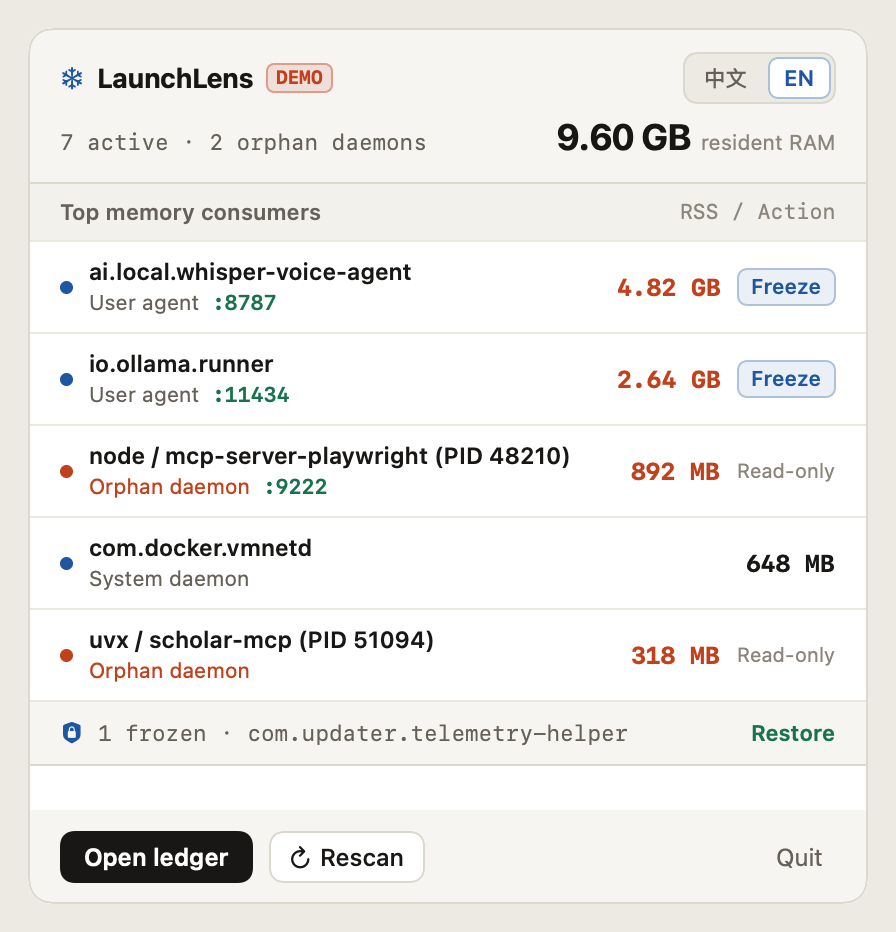

# LaunchLens

**English** | **[简体中文](README.zh-CN.md)**

**macOS user `LaunchAgents` and background service RSS ledger with deduplicated process-tree memory accounting, exact script/basename orphan detection, transactional SHA-256 freeze, conflict-checked restore, and startup ledger recovery.**


> **`[DEMO]` Screenshot Notice:** Both screenshots in this document render synthetic preview data generated by `LaunchLensMonitor.preview()` (`--export-screenshots` / `--demo`), such as `ai.local.whisper-voice-agent` (`4.82 GB`) and `com.updater.telemetry-helper` (`412 MB` reclaimed). Automated acceptance scripts never launch GUI windows; runtime launches without `--demo` always scan the live Mac and load zero demo items.

Developers on macOS accumulate background `LaunchAgents`, global/system `launchd` plists, and detached `PPID == 1` CLI / MCP processes that hold unified memory (`RSS`) and `localhost` TCP ports across terminal sessions.

**LaunchLens** is a pure-SwiftPM macOS 14+ utility (main ledger window, menu bar popover, and headless CLI) with live `中文 / EN` switching, zero third-party dependencies, zero `sudo` prompts, and zero network calls.

> **Version Status (`v0.5.0`):** `v0.5.0` builds on `v0.4.0` (`v0.3.0` M0: the 6-step rollback-safe `freeze` transaction, conflict-checked `restore`, startup integrity recovery, command confirmation sheet, `--demo`, `--cli audit`, `--help` / `-h`, `--agents-dir`, `--ledger-dir`, exit codes `1`/`2`; plus M1: deduplicated service process-tree + `Program`-matched daemon RSS accounting, exact executable/script orphan detection, CLI `--json`, and `--confirm`-gated `--cli freeze|restore|repair`) and adds the M2 milestone: before/after session `snapshot` and offline `diff` (`--json`, `--fail-on-added` exit `3`) with external `.plist` discovery, listener-orphan deduplication, and sensitive argument redaction. Items below are marked **since v0.3.0**, **since v0.4.0**, or **since v0.5.0**.
>
> **Upgrade Check for `v0.1.0` / `v0.2.0` Users:** Published `v0.1.0` and `v0.2.0` deleted the active `.plist` before persisting `ledger.json` and ignored non-zero `launchctl` exit codes. After updating to a post-`v0.2.0` build, run `build/LaunchLens.app/Contents/MacOS/LaunchLens --cli audit` (or launch the app) to detect any interrupted `"inProgress"` entries or untracked `.plist` backups in `~/Library/Application Support/LaunchLens/Snapshots/` and recover them via **Repair / Recover**.

## Verified Capabilities

- **Deduplicated Service Process-Tree RSS & TCP Port Accounting (since v0.4.0)**: Scans `~/Library/LaunchAgents`, `/Library/LaunchAgents`, and `/Library/LaunchDaemons`, summing `ps` resident memory (`RSS`) and `lsof` listening TCP ports across `{rootPID} ∪ transitiveDescendants` via `ppid` (deduplicated by PID), and cross-referencing system-domain `LaunchDaemons` without user `launchctl list` PIDs by exact `Program` / `ProgramArguments[0]` path.
- **Exact Basename & Script-Target Orphan Detection (since v0.4.0)**: Flags `uid == getuid() && ppid == 1` processes unclaimed by active `launchctl` or plist service trees using exact native daemon basenames and parsed script / `-m module` / `-jar` targets for `python*`, `node`, `deno`, `bun`, `uv`/`uvx`, `ruby`, `perl`, `java`, and shells — preserving macOS CLI framework shims (`Python.app`, `Ruby.app`) while excluding genuine GUI `.app`, `.xpc`, and `.appex` bundles and live-parent (`PPID > 1`) child processes.
- **Rollback-Safe 6-Step `freeze` Transaction (since v0.3.0)**: Validates that the target is a regular file (rejecting symlinks and duplicate labels) strictly inside `~/Library/LaunchAgents`, preflights vault directory, subdirectories, and `ledger.json` writability *before* writing any backup file, writes and SHA-256 verifies the backup in `Snapshots/`, persists an `"inProgress"` ledger entry *before* calling `/bin/launchctl bootout gui/<uid>`, checks `exitCode == 0`, moves the `.plist` to staging rather than deleting it, and commits `"frozen"` (rolling back in reverse order on any step failure).
- **Conflict-Checked `restore` (since v0.3.0)**: Verifies backup SHA-256 and vault/ledger writability before writing, refuses silent overwrite when a modified file already exists at the target path (reporting both file paths, byte sizes, SHA-256 prefixes, and a PropertyList/line diff), verifies `/bin/launchctl bootstrap` `exitCode == 0`, and preserves both backup and ledger record if `bootstrap` fails.
- **Command Confirmation & Startup Integrity Recovery (since v0.3.0; the CLI `--confirm` gate since v0.4.0)**: Freezing and restoring in both the main window and menu bar popover display a confirmation sheet showing the exact `/bin/launchctl` command and file paths, and CLI write subcommands (`--cli freeze|restore|repair`) likewise preview the exact `/bin/launchctl` command and paths and exit `2` without mutating state unless `--confirm` is explicitly passed. Startup checks surface `"inProgress"` transactions and orphaned backups with a **Repair / Recover** action: when the `.plist` is still in `~/Library/LaunchAgents`, recovery runs read-only `launchctl print gui/<uid>/<label>` (`0` = already loaded -> clean duplicate without re-bootstrapping; `113` = unloaded -> re-run `launchctl bootstrap` and require `exitCode == 0`; any other non-zero exit code -> preserve record and backup untouched and surface `recoveryPrintFailed`).
- **Read-Only System & Orphan Boundaries (since v0.3.0)**: `/Library/LaunchDaemons`, `/Library/LaunchAgents`, and `com.apple.*` items are strictly read-only. Orphaned process rows are also read-only in UI (no terminate button).
- **Live `中文 / EN` UI (`v0.2.0`) & Hardened Headless CLI (`v0.3.0`; `--json` since `v0.4.0`)**: Supports automatic locale detection, in-app `中文 | EN` toggle (`⇧⌘L`), `--json` structured output, and `--lang en|zh` on the CLI with deterministic exit codes (`0` success, `1` runtime/audit error, `2` unknown subcommand or flag).

<p align="center">
  
</p>

> **`[DEMO]` Menu Bar Caption:** Rendered from `LaunchLensMonitor.preview()` synthetic preview items (`--export-screenshots`).

## Memory Accounting Formula & Live Verification (`2026-11-15`)

### Exact RSS Accounting Formula (`L7`)
- **Service RSS**: For every service with a live root PID (from `launchctl list` or, for plists without a user `launchctl list` PID, unclaimed `ps` roots matching the plist's normalized `Program` / `ProgramArguments[0]` invocation), LaunchLens computes `{rootPIDs} ∪ transitiveDescendants(ppid)` **deduplicated by PID**, then sums `rssKB * 1024`. Idle services report `0 B`.
- **Total Non-Apple Background RSS**: Sum of deduplicated RSS across all non-`com.apple.*` services plus all detected `PPID == 1` user orphan daemons.

### Anonymized Real-Machine Cross-Check (`2026-11-15`, `Scripts/acceptance/m1-ledger.sh`)
Verified read-only on an Apple Silicon Mac (`2026-11-15`, zero private service labels or user paths recorded; before/after snapshot bracket + independent bottom-up `ppid` ancestor-chain reference in `Scripts/acceptance/m1_ledger_ref.py`):
- **Service Count & RSS Parity**: **15 / 15** `.plist` services matched **100%** (**9** User `LaunchAgents`, **3** Global `LaunchAgents`, **3** System `LaunchDaemons`); **4** active non-Apple services (**1** multi-process tree + **1** `Program`-matched `System LaunchDaemon`) totaled **81.45 MB** service RSS with **0.0000% (0.0 KB)** maximum bracketed difference against the independent bottom-up `ps` reference calculation (threshold `<= 5.0%`).
- **Listening TCP Port Parity & Excluded-Listener Breakdown**: **100%** set match against `lsof -nP -iTCP -sTCP:LISTEN` across all **24** host listening PIDs (**36** unique ports): **5** tracked listener PIDs (**5** ports: **2** steady-state service ports + **1** pre-existing `PPID == 1` Python orphan + **2** injected orphan probes), **19** excluded listener PIDs with explicit reasons (**3** Apple system processes, **2** GUI `.app` bundles, **13** active `PPID > 1` session children, **1** injected `PPID > 1` negative-control worker, **0** other-UID listeners), and **0** unaccounted listeners.
- **Orphan Precision**: **2 / 2** controlled detached `PPID == 1` TCP listeners (`node` + framework `python3`) plus **1** pre-existing live `PPID == 1` Python orphan detected with exact ports (**49.41 MB** total orphan RSS -> **130.86 MB** combined non-Apple RSS during probe window), **0** false positives on a live-parent (`PPID > 1`) `node_modules` TCP worker, and **0** false positives across **87** live `.app` bundle processes.

### Current Scope Limits & Planned Work (`Post-M2`)
- **Synthetic `[DEMO]` Screenshots Preserved (`No Headless GUI Launch`)**: Live numbers above are updated from real-host CLI verification (`reports/m1-ledger.txt`), while `docs/screenshot-main*.png` and `docs/screenshot-menubar*.png` remain `[DEMO]` synthetic preview renders because headless verification runs without opening GUI windows.
- **Opt-In Live `launchd` Round-Trip (`LAUNCHLENS_REAL_LAUNCHD=1`)**: `Scripts/acceptance/m1-real-launchd.sh` (temporary random-suffix `.plist` freeze, restore, and mid-freeze `SIGKILL` recovery) and `Scripts/acceptance/m2-snapshot-diff.sh` (temporary-directory `LaunchAgent`, `127.0.0.1` listener, and `PPID == 1` orphan residue detection + cleanup round-trip) are **OFF by default** so automated test runs never execute `bootstrap`/`bootout` on the host's live `launchd`. `m1-real-launchd.sh` was run once, on 2026-11-17, on one machine with `LAUNCHLENS_REAL_LAUNCHD=1`, and exited `0`: a temporary user LaunchAgent (`/bin/sleep 300`) was loaded, frozen and restored (plist byte-identical), and `repair` after a `SIGKILL` at each of two interruption points (`afterBootout`, `afterRemoveOriginalPlist`) passed; the 9 existing user LaunchAgents on that machine were unchanged in content and modification time and nothing was left behind. Scope: one machine, one user-level LaunchAgent, one run. `Scripts/test.sh milestone 1` still counts this row as skipped, and `Scripts/test.sh milestone 2` exits `2` unless `LAUNCHLENS_REAL_LAUNCHD=1` is explicitly set.
- **Planned (Post-`M2`)**: Session attribution for leftover coding-agent MCP processes, read-only port/service query MCP tools, and historical RSS integration via ChronoMac.

## Install & Build (macOS 14.0+, Apple Silicon)

### Homebrew Cask (`v0.5.0`, published release)

```bash
brew install --cask zxu756/tap/launchlens
```

### Build & Scoped Verification from Source (since v0.3.0)

```bash
./Scripts/test.sh scope Freeze Scanner CLI UI
./Scripts/build-app.sh
```

After building, launch `build/LaunchLens.app` from Finder (or pass `--demo`, since `v0.3.0`, to inspect the labeled synthetic preview dataset).

## Headless CLI Usage

### Isolated Fixture Verification (since v0.3.0)

`--agents-dir`, `--ledger-dir`, `--json`, `--cli audit`, and `--help` are available since `v0.3.0` (`--json` since `v0.4.0`) so CLI checks can run hermetically without reading or touching `~/Library/LaunchAgents` (replayed in `Scripts/acceptance/readme-commands.sh`):

```bash
# List services and orphans against isolated directories (--agents-dir, --ledger-dir, --json: since v0.4.0; the others since v0.3.0)
build/LaunchLens.app/Contents/MacOS/LaunchLens --cli list --agents-dir "${AGENTS_DIR:-.}" --ledger-dir "${LEDGER_DIR:-${TMPDIR:-/tmp}}" --lang en
build/LaunchLens.app/Contents/MacOS/LaunchLens --cli list --agents-dir "${AGENTS_DIR:-.}" --ledger-dir "${LEDGER_DIR:-${TMPDIR:-/tmp}}" --lang zh
build/LaunchLens.app/Contents/MacOS/LaunchLens --cli list --json --agents-dir "${AGENTS_DIR:-.}" --ledger-dir "${LEDGER_DIR:-${TMPDIR:-/tmp}}" --lang en
build/LaunchLens.app/Contents/MacOS/LaunchLens --cli orphans --agents-dir "${AGENTS_DIR:-.}" --ledger-dir "${LEDGER_DIR:-${TMPDIR:-/tmp}}" --lang en
build/LaunchLens.app/Contents/MacOS/LaunchLens --cli orphans --agents-dir "${AGENTS_DIR:-.}" --ledger-dir "${LEDGER_DIR:-${TMPDIR:-/tmp}}" --lang zh

# Inspect SHA-256 verified frozen snapshots and run ledger audit (--cli audit & --help: since v0.3.0)
build/LaunchLens.app/Contents/MacOS/LaunchLens --cli frozen --ledger-dir "${LEDGER_DIR:-${TMPDIR:-/tmp}}" --lang en
build/LaunchLens.app/Contents/MacOS/LaunchLens --cli frozen --ledger-dir "${LEDGER_DIR:-${TMPDIR:-/tmp}}" --lang zh
build/LaunchLens.app/Contents/MacOS/LaunchLens --cli audit --ledger-dir "${LEDGER_DIR:-${TMPDIR:-/tmp}}" --lang en
build/LaunchLens.app/Contents/MacOS/LaunchLens --cli audit --ledger-dir "${LEDGER_DIR:-${TMPDIR:-/tmp}}" --lang zh
build/LaunchLens.app/Contents/MacOS/LaunchLens --help --lang en
build/LaunchLens.app/Contents/MacOS/LaunchLens --help --lang zh
```

### Interactive Live-Host Inspection (Default `~/Library/LaunchAgents`)

Omitting `--agents-dir` scans your live `~/Library/LaunchAgents`, `/Library/LaunchAgents`, and `/Library/LaunchDaemons` (read-only; skipped in `milestone 0` / isolated README checks and executed in `release` mode only):

```bash
# Scan live host LaunchAgents and background RSS (interactive use / release mode)
build/LaunchLens.app/Contents/MacOS/LaunchLens --cli list --lang en
build/LaunchLens.app/Contents/MacOS/LaunchLens --cli list --lang zh
```

## Before/After Session Snapshots (`snapshot` / `diff`, `M2`, since `v0.5.0`)

Take a point-in-time snapshot before and after a coding-agent session, then compare the two JSON files offline to detect newly added background `launchd` services (including `.plist` definitions bootstrapped from external temporary directories), current-user `TCP LISTEN` ports (dual-stack merged by `(port, invocationIdentity)`), and non-listening `PPID == 1` orphan processes. Detached processes holding a listening port are reported once under **Listening Ports** (`[orphan]`) rather than double-counted under **Orphan Processes** (`D1`), and sensitive CLI values (`--token=...`, `API_KEY=...`, `Authorization: ...`) are redacted to `***` before writing to disk.

### Subcommand Syntax

Both direct subcommands and the `--cli` prefix are accepted (`D3`). `snapshot` writes atomically (`temp -> fsync -> rename`) to the path you specify without creating an internal database; `diff` reads only the two JSON files and never queries live OS state:

```text
LaunchLens [--cli] snapshot <file> [--lang en|zh]
LaunchLens [--cli] diff <before> <after> [--json] [--fail-on-added] [--lang en|zh]
```

### Offline Fixture Replay (Verified by `Scripts/acceptance/readme-commands.sh`)

```bash
# Compare sanitized before/after session snapshots purely offline (zero host OS reads)
build/LaunchLens.app/Contents/MacOS/LaunchLens diff Tests/Fixtures/m2-snapshot-before.json Tests/Fixtures/m2-snapshot-after.json --lang en
build/LaunchLens.app/Contents/MacOS/LaunchLens diff Tests/Fixtures/m2-snapshot-before.json Tests/Fixtures/m2-snapshot-after.json --lang zh
build/LaunchLens.app/Contents/MacOS/LaunchLens diff Tests/Fixtures/m2-snapshot-before.json Tests/Fixtures/m2-snapshot-after.json --json
```

Sample output (`--lang en` — note that `io.example.sync-helper` restarting from `PID 1410` to `PID 1920` produces `~0 modified`, while the external temporary `.plist`, detached listener, and redacted orphan are reported):

```text
Services: +1 added, -0 removed, ~0 modified
  + [user] com.example.relay-worker | plist: /private/tmp/agent-demo/com.example.relay-worker.plist | program: /bin/sleep 300
Listening Ports: +1 added, -0 removed
  + :18765 | bind: 127.0.0.1 | PID 6200 [orphan] | program: /usr/bin/python3 /opt/example/mcp_server.py --port 18765
Orphan Processes: +1 added, -0 removed
  + PID 6205 | started: Sat Nov 21 08:04:12 2026 | program: /usr/bin/python3 /opt/example/orphan_worker.py --token=*** API_KEY=***
```

### Exit Codes (`snapshot` & `diff`, `D2`)

| Exit Code | Subcommand | Condition |
|---:|---|---|
| `0` | `snapshot`, `diff` | `snapshot` captured and atomically wrote JSON; `diff` succeeded without triggering `--fail-on-added` (including zero diff, removals only, or same-key service modifications only) |
| `1` | `snapshot`, `diff` | `launchctl`/`ps`/`lsof` returned non-zero, target path unwritable (temporary file cleaned up), missing/unreadable/corrupt JSON, or unsupported `schemaVersion` |
| `2` | `snapshot`, `diff` | Missing or extra positional arguments, unknown flag, or invalid `--lang` |
| `3` | `diff --fail-on-added` | `--fail-on-added` passed and at least one service, listening port, or orphan process was added (`hasAdditions == true`) |

### Using with `agent-relay` (Per-Step Wrapper, `D6`)

Per `M2` decision `D6`, LaunchLens does not modify the global `~/.agents/skills/agent-relay/scripts/relay.sh` script yet (direct `relay.sh` hook integration is deferred until combined with ChronoMac `mark`). Wrap each relay step externally by storing before/after snapshots inside `.relay/` (which `relay.sh` already excludes via `.git/info/exclude`):

```text
build/LaunchLens.app/Contents/MacOS/LaunchLens snapshot .relay/01-step.before.json
~/.agents/skills/agent-relay/scripts/relay.sh codex "$WORKDIR" 01-step .relay/01-step.prompt.md
build/LaunchLens.app/Contents/MacOS/LaunchLens snapshot .relay/01-step.after.json
build/LaunchLens.app/Contents/MacOS/LaunchLens diff .relay/01-step.before.json .relay/01-step.after.json --fail-on-added
```

## Architecture & Specification

See [docs/SPEC.md](docs/SPEC.md) for the service RSS formula, orphan classification rules, 6-step freeze transaction, restore conflict handling, startup recovery, and CLI exit code contract.

## License

MIT
