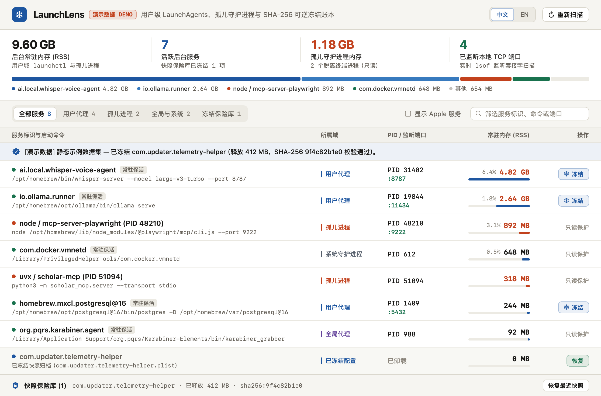
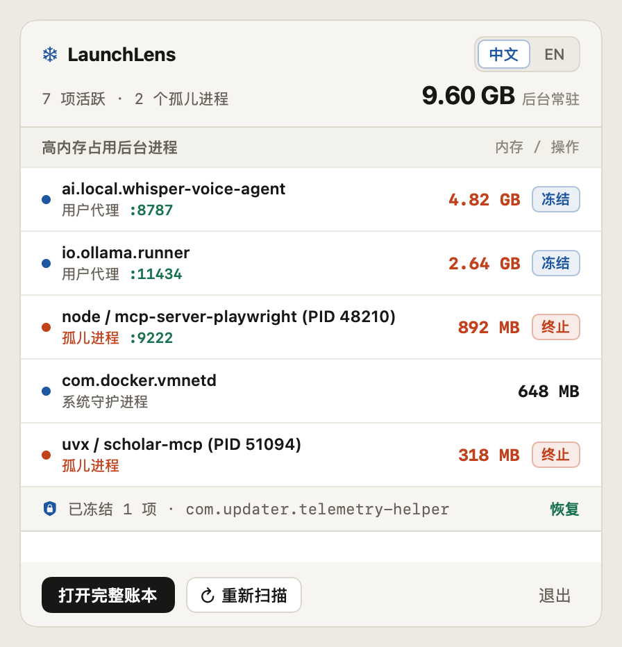

# LaunchLens

**[English](README.md)** | **简体中文**

**面向 macOS 的用户级 `LaunchAgents` 与后台服务常驻内存（RSS）账本：支持可回滚的 SHA-256 事务型冻结、冲突比对恢复与启动台账自检。**



> **`[演示数据 / DEMO]` 截图说明：** 本文档中的两张界面截图均由 `LaunchLensMonitor.preview()`（`--export-screenshots` / `--demo`）静态示例数据渲染（如 `ai.local.whisper-voice-agent` 占 `4.82 GB`、`com.updater.telemetry-helper` 释放 `412 MB`），并非采自本机真实进程。正常启动（不带 `--demo`）时均实时扫描本机，不载入任何演示数据。

在 macOS 开发环境中，长期驻留的 `LaunchAgents`、全局/系统 `launchd` 配置项以及终端退出后残留的 `PPID == 1` CLI / MCP 进程会持续占用统一内存（RSS）与本地 `localhost` TCP 端口。

**LaunchLens** 是纯 SwiftPM 构建的原生 macOS 14+ 工具（包含主账本窗口、菜单栏弹窗与无头 CLI），支持应用内 `中文 / EN` 实时切换，零第三方依赖、零 `sudo` 提权提示、零网络请求。

> **版本状态说明（`v0.3.0`）：** `v0.3.0` 只包含 M0「去假」里程碑，替换 `v0.2.0`。包含中英双语主窗口、菜单栏弹窗、`--cli list|orphans|frozen|audit`（`--lang zh|en`）、6 步可回滚 `freeze` 事务、防覆盖 `restore`、启动完整性恢复、操作前命令确认框、`--demo` 演示开关、`--help` / `-h`、`--agents-dir`、`--ledger-dir` 与退出码 `1`/`2`。孤儿进程判定与内存统计将在 M1 重写，本版未经验证。
>
> **`v0.1.0` / `v0.2.0` 用户升级自检提示：** 已发布的 `v0.1.0` 与 `v0.2.0` 在冻结时先删除原 `.plist` 最后才写 `ledger.json`，且未检查 `launchctl` 退出码。升级到 `v0.2.0` 之后的构建版本后，可执行 `build/LaunchLens.app/Contents/MacOS/LaunchLens --cli audit --lang zh`（或直接打开应用），检查 `~/Library/Application Support/LaunchLens/Snapshots/` 中是否存在中断的「进行中」记录或无记录孤儿备份文件，并通过 **修复 / 恢复** 找回。

## 已验证能力

- **Plist 清单与用户域 RSS 关联（`v0.2.0`）**：扫描 `~/Library/LaunchAgents`、`/Library/LaunchAgents` 与 `/Library/LaunchDaemons`，将当前用户域 `launchctl list` 返回的 PID 与 `ps` 常驻内存（RSS）及 `lsof` 监听 TCP 端口关联。
- **可回滚的 6 步事务型冻结 `freeze`（`v0.3.0` 起）**：先通过 `lstat` 校验目标为严格位于 `~/Library/LaunchAgents` 下的普通文件（拒绝符号链接与重复 `label`），在写入任何备份文件之前先预检台账目录、子目录与 `ledger.json` 可写性，随后在 `Snapshots/` 写入原字节备份并校验读回 SHA-256，在调用 `/bin/launchctl bootout gui/<uid>` **之前**先向 `ledger.json` 落盘「进行中」（`inProgress`）记录，再校验 `bootout` 退出码为 `0`，随后将原 `.plist` 移入暂存区（不直接删除），最后更新台账为「已冻结」（`frozen`）；任意步骤失败均按逆序回滚并明确报告失败步骤与当前状态。
- **防覆盖与退出码校验的恢复 `restore`（`v0.3.0` 起）**：恢复前先校验备份 SHA-256 与台账可写性；若目标位置已存在同名文件（例如软件更新后重建了新配置），拒绝静默覆盖并列出两份文件的路径、字节大小、SHA-256 前缀与键值差异供用户选择；执行 `/bin/launchctl bootstrap` 失败时完整保留备份文件与台账记录。
- **命令确认弹窗与启动完整性恢复（`v0.3.0` 起）**：在主窗口和菜单栏弹窗点击「冻结」或「恢复」时均先弹出确认框，展示即将执行的完整 `/bin/launchctl` 命令与文件路径；启动时自动检测「进行中」记录与孤儿备份文件，点击「修复 / 恢复」时：若原 `.plist` 仍在 `~/Library/LaunchAgents` 中，先通过只读的 `launchctl print gui/<uid>/<label>` 判断服务是否已加载（`bootout` 前中断直接清理记录，避免重复 `bootstrap` 报错；`bootout` 后中断则重新执行 `launchctl bootstrap` 并校验退出码为 `0`）；若原 `.plist` 已移出 `~/Library/LaunchAgents` 且恢复时 `bootstrap` 失败，则移除临时目标副本并将记录降为「已冻结」（`frozen`），以便后续手动恢复。
- **系统服务与孤儿进程只读保护（`v0.3.0` 起）**：`/Library/LaunchDaemons`、`/Library/LaunchAgents` 与 `com.apple.*` 服务严格只读；M0 阶段孤儿进程行同样严格只读（界面已移除「终止进程」按钮）。
- **实时 `中文 / EN` 切换（`v0.2.0`）与规范 CLI 退出码（`v0.3.0` 起）**：支持自动识别中文系统语言、界面 `中文 | EN` 切换胶囊（`⇧⌘L`）及命令行 `--lang zh|en`，严格区分退出码（`0` 成功、`1` 运行或自检异常、`2` 未知子命令或非法参数）。

<p align="center">
  
</p>

> **`[演示数据 / DEMO]` 菜单栏图注：** 由 `LaunchLensMonitor.preview()` 静态示例数据导出（`--export-screenshots`）。

## 当前测量口径与后续计划（`M1+`）

### M0 测量口径边界
- **用户域 `launchctl` 内存汇总口径（`L7`）**：非特权 `/bin/launchctl list` 仅返回当前用户 GUI 域服务的 PID。系统域（`/Library/LaunchDaemons`）守护进程在无 root 权限的 `launchctl list` 中不可见 PID（M0 中显示为 `空闲` / `0 MB`），且不由 plist 主进程 PID 直接代表的独立子进程/辅助进程暂未合并计入该服务 RSS。
- **孤儿进程启发式判定与只读限制（`L4, L5`）**：M0 对未被 `launchctl list` 认领且满足 `uid == currentUID && ppid == 1` 的进程采用命令行子串匹配（`node`、`python`、`uvx`、`mcp` 等），并跳过含 `.app/Contents/` 的路径。由于 macOS 框架版 Python 路径带有 `Python.app/Contents/MacOS/Python` 会被跳过、且参数含同名子串的普通进程可能被命中，M0 阶段孤儿列表仅作只读展示。

### 后续计划（`M1+`）
- **M1**：按可执行文件名与实际运行脚本重写孤儿进程判定（覆盖框架版 `Python.app`），补齐含全部子进程及按 `Program` 路径反查系统守护进程的内存口径并由 `m1-ledger.sh` 对照验证，提供通过 `LAUNCHLENS_REAL_LAUNCHD=1` 显式开启的真实环境冻结回环测试。
- **M2**：为残留 MCP/开发孤儿进程标注来源 Agent 会话、提供只读端口与服务查询 MCP 工具、对接 ChronoMac 读取历史内存趋势。

## 安装与编译（macOS 14.0+，Apple Silicon）

### Homebrew Cask 安装（`v0.3.0`，已发布版本）

```bash
brew install --cask zxu756/tap/launchlens
```

> 首次打开未经公证的 ad-hoc 签名构建包时，如遇 Gatekeeper 提示，可执行一次 `xattr -cr /Applications/LaunchLens.app`。

### 从源码编译与范围验证（`v0.3.0` 起）

```bash
./Scripts/test.sh scope Freeze Scanner CLI UI
./Scripts/build-app.sh
```

编译完成后可在访达中打开 `build/LaunchLens.app`（如需查看带标签的静态演示数据，可传入 `--demo`，`v0.3.0` 起新增参数）。

## 命令行（Headless CLI）用法

### 隔离夹具验证（`v0.3.0` 起）

`--agents-dir`、`--ledger-dir`、`--cli audit` 与 `--help` 自 `v0.3.0` 起新增，可在不读取、不触碰本机 `~/Library/LaunchAgents` 的前提下执行隔离验证（由 `Scripts/acceptance/readme-commands.sh` 自动提取并逐条断言）：

```bash
# 指定隔离目录列出后台服务与孤儿进程（--agents-dir 与 --ledger-dir：v0.3.0 起）
build/LaunchLens.app/Contents/MacOS/LaunchLens --cli list --agents-dir "${AGENTS_DIR:-.}" --ledger-dir "${LEDGER_DIR:-${TMPDIR:-/tmp}}" --lang en
build/LaunchLens.app/Contents/MacOS/LaunchLens --cli list --agents-dir "${AGENTS_DIR:-.}" --ledger-dir "${LEDGER_DIR:-${TMPDIR:-/tmp}}" --lang zh
build/LaunchLens.app/Contents/MacOS/LaunchLens --cli orphans --agents-dir "${AGENTS_DIR:-.}" --ledger-dir "${LEDGER_DIR:-${TMPDIR:-/tmp}}" --lang en
build/LaunchLens.app/Contents/MacOS/LaunchLens --cli orphans --agents-dir "${AGENTS_DIR:-.}" --ledger-dir "${LEDGER_DIR:-${TMPDIR:-/tmp}}" --lang zh

# 查看已冻结快照与执行台账完整性自检（--cli audit 与 --help：v0.3.0 起）
build/LaunchLens.app/Contents/MacOS/LaunchLens --cli frozen --ledger-dir "${LEDGER_DIR:-${TMPDIR:-/tmp}}" --lang en
build/LaunchLens.app/Contents/MacOS/LaunchLens --cli frozen --ledger-dir "${LEDGER_DIR:-${TMPDIR:-/tmp}}" --lang zh
build/LaunchLens.app/Contents/MacOS/LaunchLens --cli audit --ledger-dir "${LEDGER_DIR:-${TMPDIR:-/tmp}}" --lang en
build/LaunchLens.app/Contents/MacOS/LaunchLens --cli audit --ledger-dir "${LEDGER_DIR:-${TMPDIR:-/tmp}}" --lang zh
build/LaunchLens.app/Contents/MacOS/LaunchLens --help --lang en
build/LaunchLens.app/Contents/MacOS/LaunchLens --help --lang zh
```

### 本机交互式只读扫描（默认读取 `~/Library/LaunchAgents`）

不传 `--agents-dir` 时默认只读扫描当前机器的 `~/Library/LaunchAgents`、`/Library/LaunchAgents` 与 `/Library/LaunchDaemons`（`milestone 0` 验收中跳过，仅在 `release` 模式下回放）：

```bash
# 只读扫描本机真实 LaunchAgents 与后台常驻内存（交互式使用 / release 模式）
build/LaunchLens.app/Contents/MacOS/LaunchLens --cli list --lang en
build/LaunchLens.app/Contents/MacOS/LaunchLens --cli list --lang zh
```

## 架构与设计规范

6 步冻结事务、恢复冲突比对、启动恢复与 CLI 退出码约定详见 [docs/SPEC.md](docs/SPEC.md)。

## 开源协议

MIT
